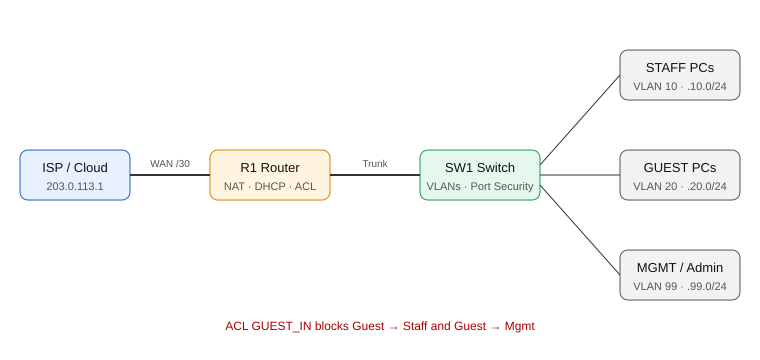

# Cisco Campus Network Lab

A small campus network built in **Cisco Packet Tracer**: VLAN segmentation, inter-VLAN routing, DHCP, guest isolation with an ACL, NAT, port security and SSH-only management.

## What this project shows
| Skill | Where |
|---|---|
| VLANs & 802.1Q trunking | `SW1-switch.txt` |
| Inter-VLAN routing (router-on-a-stick) | `R1-router.txt` |
| DHCP server on router | `R1-router.txt` |
| Network segmentation with ACLs | `GUEST_IN` ACL |
| NAT overload (PAT) | `R1-router.txt` |
| Layer 2 hardening: port security, BPDU guard, unused ports shut | `SW1-switch.txt` |
| Secure management: SSH v2 only, vty restricted to MGMT VLAN | both configs |

## Addressing plan
| VLAN | Name | Subnet | Gateway | Purpose |
|---|---|---|---|---|
| 10 | STAFF | 192.168.10.0/24 | 192.168.10.1 | Staff PCs (DHCP) |
| 20 | GUEST | 192.168.20.0/24 | 192.168.20.1 | Guest PCs (DHCP, isolated) |
| 99 | MGMT | 192.168.99.0/24 | 192.168.99.1 | Device management (SW1 = .2) |
| 999 | UNUSED | — | — | Native VLAN and parked ports |
| WAN | — | 203.0.113.0/30 | R1 = .2, ISP = .1 | Internet side (documentation range) |

## Build it (about 20 minutes)
1. In Packet Tracer add: 1 router (2911), 1 switch (2960), 1 cloud/router as ISP, 2 PCs per VLAN, 1 admin PC.
2. Cable: R1 `Gi0/0` ↔ SW1 `Gi0/1` (trunk), R1 `Gi0/1` ↔ ISP.
3. Staff PCs → `Fa0/1-10`, Guest PCs → `Fa0/11-20`, set PCs to **DHCP**. Put the admin PC on VLAN 99 with a static IP (192.168.99.10/24, gateway 192.168.99.1).
4. Paste [`configs/SW1-switch.txt`](configs/SW1-switch.txt) into SW1, then [`configs/R1-router.txt`](configs/R1-router.txt) into R1.
5. Run the tests below and save screenshots in `docs/images/`.

## Test plan
| # | Test | Command / action | Expected | Evidence |
|---|---|---|---|---|
| 1 | VLANs exist | `show vlan brief` on SW1 | 10, 20, 99, 999 listed | `docs/images/01-vlans.png` |
| 2 | Trunk is up | `show interfaces trunk` | Gi0/1 trunking, allowed 10,20,99 | `docs/images/02-trunk.png` |
| 3 | DHCP works | PC → `ipconfig` | Staff gets 192.168.10.x, Guest gets 192.168.20.x | `docs/images/03-dhcp.png` |
| 4 | Inter-VLAN routing | Staff PC pings gateway and Mgmt gateway | Replies | `docs/images/04-routing.png` |
| 5 | Guest isolation | Guest PC pings a Staff PC and 192.168.99.1 | **Request timed out / blocked** | `docs/images/05-acl-block.png` |
| 6 | ACL hit counters | `show access-lists` on R1 | Deny lines show matches | `docs/images/06-acl-hits.png` |
| 7 | NAT | Staff PC pings ISP 203.0.113.1, then `show ip nat translations` | Translations listed | `docs/images/07-nat.png` |
| 8 | Port security | Plug a second device into a Staff port, `show port-security interface fa0/1` | Violation count increases | `docs/images/08-portsec.png` |
| 9 | SSH only | Admin PC: `ssh -l admin 192.168.99.1` works; Telnet refused | SSH OK, Telnet fails | `docs/images/09-ssh.png` |

> Note: the ACL sits inbound on the Guest VLAN, so Guest cannot reach Staff or Mgmt, and replies from Guest to Staff are dropped too. Guests can still reach the internet.

## Possible improvements (next steps)
- Add a second switch with EtherChannel and Rapid-PVST
- Add DHCP snooping and Dynamic ARP Inspection
- Send syslog to a SIEM (ties in with my SIEM lab)

## Related certificates
Cisco *Networking Basics* and *Operating Systems Basics* — see my [profile](https://github.com/Velmurugan-Security07).

## Author
**Velmurugan A.** · [GitHub](https://github.com/Velmurugan-Security07) · [LinkedIn](https://www.linkedin.com/in/velmurugan-anand)
